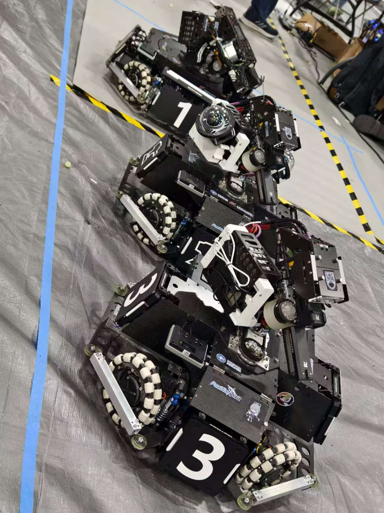
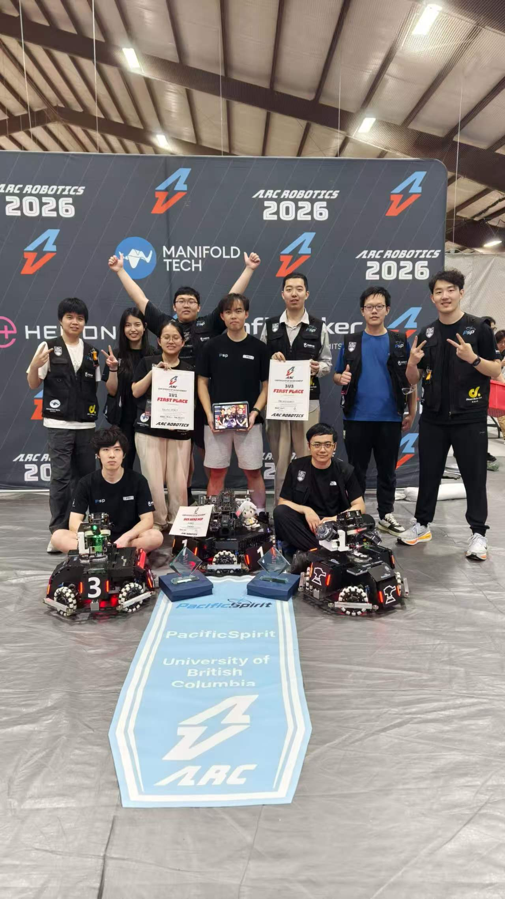

# Pacific Spirit RoboMaster — Robotics Portfolio

A technical portfolio showcasing my contributions to UBC's Pacific Spirit robotics design team, focusing on computer vision, autonomous navigation, mapping, and robotic systems integration.

## About the Project

Pacific Spirit is a student-led robotics design team at the University of British Columbia that develops competitive robotic systems.

Since October 2025, I have contributed to computer vision and autonomous navigation, working with physical robots, sensor data, and interconnected software components.

## Technical Contributions

### Autonomous Navigation & Mapping
- Integrated ROS 2 navigation and mapping components.
- Worked with LiDAR point cloud filtering, grid maps, and occupancy grid generation.
- Debugged mapping pipelines and spatial alignment issues.

### Coordinate Transformations
- Worked with ROS 2 TF2 transformations between `map`, `odom`, and `base_link`.
- Investigated coordinate frame inconsistencies using RViz and ROS 2 debugging tools.
- Supported consistent spatial representation across robotic components.

### Computer Vision
- Developed and refined computer vision pipelines using OpenCV.
- Performed iterative testing and parameter tuning in dynamic environments.
- Addressed challenges involving lighting variations, motion blur, and moving targets.

### System Integration
- Diagnosed communication issues between ROS 2 nodes.
- Worked with launch configurations and software dependencies.
- Collaborated with multidisciplinary engineering teams during on-site robot testing and competition.

## Competition Achievements

**ARC Robotics 2026**

- 1v1 — First Place
- 3v3 — First Place

## Technical Skills

- **Languages:** Python, C++, C
- **Robotics:** ROS 2, TF2, RViz
- **Computer Vision:** OpenCV
- **Mapping:** LiDAR, Point Clouds, Occupancy Grids
- **Development Tools:** Linux (Ubuntu), Git, GitHub

## Portfolio Website

The portfolio includes technical descriptions, system architecture diagrams, competition photographs, and a robot demonstration video.

Built using HTML and CSS and hosted through GitHub Pages.

## About Me

I am a third-year Computer Science student at the University of British Columbia interested in robotics, software engineering, artificial intelligence, and human-computer interaction.

- **GitHub:** [Melody2026](https://github.com/Melody2026)
- **Email:** Melodywu616@gmail.com

## Note

This repository is a personal engineering portfolio documenting my individual contributions within a collaborative robotics project. It does not contain the team's proprietary source code.
